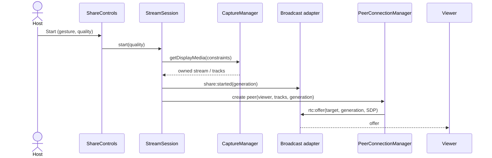
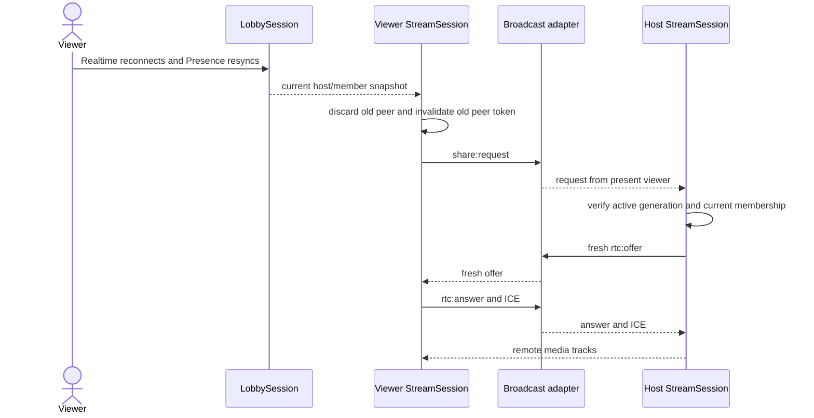

# Phase 3: WebRTC Screen Sharing — Design

## Existing architecture and reusable interfaces

- `LobbySession` in `lib/realtime/session.ts` owns lobby membership, reconnect, immutable snapshots, and Presence-derived `hostMemberId`; `getBrowserLobbySession()` provides the shared browser instance. Phase 3 consumes these contracts and must not add another source of host authority.
- `lib/realtime/events.ts` exports `RealtimeEvent`, `parseRealtimeEvent(unknown)`, and Presence parsing. Its existing offer/answer/ICE shapes can be retained and extended with a generation ID. `lib/realtime/channel.ts` exposes a `LobbyChannel` receive seam but currently has no Broadcast send method; add typed send at this seam, keeping raw Supabase APIs out of feature modules.
- `lib/config.ts` centralizes lobby/chat policy. `.env.example` documents optional `NEXT_PUBLIC_TURN_URL`, username, and credential; `lib/webrtc/ice.ts` is currently a TODO placeholder. Public configuration must be parsed/validated without treating values as secret.
- `lib/webrtc/capture.ts`, `media.ts`, `peer-manager.ts`, and `ice.ts` contain TODOs only. `store/stream.ts`, `components/ShareControls.tsx`, and `components/VideoStage.tsx` are placeholders. The current lobby route is `app/lobby/[code]/page.tsx`; it binds `useLobbyStore`, reads localized `messages`, and renders `MemberList`.
- Tests are Vitest pure/interface tests under `tests/`; the repo has no DOM rendering library. Use injected browser APIs and fake peer/media adapters for deterministic behavior; retain manual browser verification for actual negotiation and media.

## Module responsibilities and seams

Keep one browser-side stream-session coordinator as the deep module consumed by the lobby UI. It owns the active share generation, role reconciliation, member reconciliation, capture, per-peer lifecycle, signaling dispatch, recovery timers, and cleanup. Its caller-facing surface should be small: subscribe/get snapshot, host `start(quality)` and `stop()`, viewer `enablePlayback()`/`fullscreen()`, and `dispose()`; do not expose peer connections or Supabase channels to React.

| Module | Responsibility |
| --- | --- |
| Capture manager (`lib/webrtc/capture.ts`) | Validate environment/role preconditions, call injected `getDisplayMedia` from explicit action, request preset constraints, classify cancellation/denial/unsupported/missing audio, return owned tracks, watch `ended`, and stop idempotently. |
| Media policy (`lib/webrtc/media.ts`) | Pure quality preset constraints, default target, supported sender bitrate calculation/application decision, and capture capability projection. |
| ICE config (`lib/webrtc/ice.ts`) | Purely validate public STUN/TURN environment input into `RTCConfiguration`; supply public STUN defaults; expose whether TURN exists for guidance without claiming secret handling. |
| Peer connection manager (`lib/webrtc/peer-manager.ts`) | Own one `RTCPeerConnection` per remote member per generation; add host tracks, negotiate SDP, queue ICE until remote description, attach remote tracks, classify state transitions, and close idempotently. Take constructor/config/scheduler adapters as dependencies. |
| Signaling adapter (extend `lib/realtime/channel.ts`) | Add typed Broadcast send while preserving validated receive. Convert raw event payloads to `unknown` and validate before delivery. It owns no session policy or peer objects. |
| Session coordinator (`lib/webrtc/session.ts`, proposed) | Reconcile lobby snapshots and signals against current generation, self/host IDs, and observed members; coordinate capture and peer manager; implement late join, bounded recovery, state projection, generation invalidation, and centralized teardown. |
| Stream Zustand store (`store/stream.ts`) | Mirror immutable coordinator snapshot for React. No resource ownership, timers, peer calls, or persistence. |
| UI (`ShareControls`, `VideoStage`, lobby route) | Render localized controls, preview/remote media, status and recovery guidance; call coordinator actions only. Bind video elements using refs and detach `srcObject` at cleanup. |

Dependencies enter through the coordinator/module factory: lobby snapshot source, typed signaling send/subscribe, capture adapter, `RTCPeerConnection` factory, media element/play adapter, clock/timer scheduler, and optional capability/parameter adapters. Production adapters use browser APIs. Tests replace only seams they need; pure policies remain ordinary functions.

## State ownership and lifecycle

Lobby session remains the only owner of `members`, `hostMemberId`, lobby connection status, and member identity. Stream session owns ephemeral share/peer state in memory, with a monotonically unique generation token created at each host start. Zustand mirrors both kinds of state but is not authoritative. No share, SDP, ICE, stream, or chat content is persisted.

Suggested stream state union:

```ts
type ShareState =
  | { status: "idle" }
  | { status: "requesting-capture"; generation: string }
  | { status: "sharing"; generation: string; quality: QualityPreset; audio: "present" | "missing" }
  | { status: "loading" | "connecting" | "playing" | "interrupted"; generation: string; viewerId: string | null }
  | { status: "failed"; generation: string | null; reason: StreamFailure };
```

Exact union may evolve during implementation, but lifecycle transitions must remain explicit. Every asynchronous callback closes over a generation and peer identity; stale closures return without publishing state or sending signals. Stop invalidates the generation before awaiting cleanup. Teardown attempts each resource independently so one failed close does not prevent stopping tracks/removing listeners.

## Signaling and identity checks

Before dispatch, parse the raw value as `unknown` through the typed event parser. Then require: generation matches current share; sender ID exists in the latest usable lobby roster (or a narrowly defined reconnect grace case); target equals this client's member ID for targeted variants; host/viewer role is consistent with event type; and payload limits pass. The host accepts negotiation requests only from present non-host members and one peer per member/generation. The viewer accepts offers only from the current observed host. Never infer authorization from those checks.

Extend event variants with a bounded opaque `sessionId`/generation on `rtc:offer`, `rtc:answer`, `rtc:ice`, `share:started`, `share:stopped`, and `share:request`. Include generation in responses and queued candidates. Share notices should be targeted where practical or interpreted only from the observed host. Add a bounded event rate/duplicate guard where it can be enforced locally. Do not accept generic or old-generation messages as current negotiation input.

## Main flows

### Host starts sharing

The host gesture calls capture. On success, generate a fresh generation, attach the owned capture stream to a preview that is muted, broadcast share-started, and create one peer per current non-host member. Each peer receives the host tracks, creates/sets an offer, and sends the targeted offer. ICE candidates are sent as they are gathered. If capture ends or host identity changes at any point, invalidate generation and stop.

### Late viewer

Viewer subscribes to Broadcast before relying on share state. Once lobby Presence and channel subscription are current, it sends `share:request` with its identity. If host has active capture and viewer is still present, host creates a fresh peer for that member/generation and sends an offer. On reconnect, discard old peer and candidate queue, then repeat the request/negotiation. This avoids replaying stale SDP and handles a viewer arriving during an active share.

### Offer/answer and ICE

Host offer → viewer validates host, target, generation; sets remote description; creates/sets answer; sends answer → host validates and sets remote description. Both sides send candidates tagged with peer+generation; receiver queues until remote description is ready and applies each valid candidate once. Candidate-add errors are contained and surfaced as connection failure only when the connection cannot recover.

### Recovery

**Approved Task 07 policy:** temporary Host Realtime disconnection receives a 10-second grace period. LobbySession remains the sole authority for membership and host election. If the current host reconnects with current membership within the grace period, the coordinator cancels the timer and continues; if the grace expires, it releases the stream resources and follows LobbySession's existing loss/election result. Explicit leave is immediate. This timer is separate from peer recovery.

For WebRTC peers, `disconnected` receives a 5-second grace; recovery cancels that timer. `failed` recovers immediately. Both paths receive at most one ICE restart negotiation, then at most one peer recreation with a fresh negotiation and a bounded 1-second delay. Exhaustion closes the peer and marks the stream failed. `restartIce()` is runtime-capability checked. No retry occurs after member removal, generation invalidation, host migration, or disposal. Timers are injected and cancelled on lifecycle invalidation.

### Stop and host migration

Stop invalidates generation first, best-effort broadcasts stopped, detaches all listeners/timers, closes every peer, stops every local track, clears preview references, and publishes idle. The same path handles native track end, host departure, loss of host status, and explicit Stop. A new host's stream session remains idle and requires a fresh user gesture.

## Browser compatibility and quality

Use `getDisplayMedia` feature detection plus `navigator.userAgentData`/capability checks only as advisory UI; do not rely on brittle user-agent detection to gate native API capability. Desktop Chrome/Edge are primary capture acceptance targets. Other desktop browsers may work but are best effort. Mobile viewer support depends on browser WebRTC codecs, autoplay policy, and hardware; mobile capture controls are omitted. Capture constraints ask for selected resolution/FPS but source/browser may override. Bitrate is applied only when sender parameter APIs are present and valid; rejected parameter updates do not fail sharing.

STUN configuration permits direct ICE discovery only. TURN relays encrypted peer media when direct paths fail but incurs relay transfer charges and requires capacity/abuse management. Static `NEXT_PUBLIC_TURN_*` variables are visible in downloaded app code; avoid putting privileged long-lived credentials there. Secure issuance requires an external trusted credential issuer, deliberately outside this phase unless approved.

## Error handling and accessibility

Map internal failures to typed reasons, not raw browser exceptions. Capture denial offers settings/chooser guidance; unsupported capture indicates desktop Chrome/Edge; missing audio says video can continue and suggests enabling tab audio; connectivity failure explains that restrictive networks may require TURN. Autoplay rejection exposes an explicit Play/Enable audio button. Use `role="status"` or `aria-live="polite"` for state updates and `role="alert"` for terminal failures. All actions support keyboard focus and labels in both dictionaries. Preserve page `dir="rtl"`; use `<bdi>` for IDs/technical strings.

## Mermaid sequences

### 1. Host starts sharing



### 2. Viewer joins and receives media

```mermaid
sequenceDiagram
  actor Viewer
  participant L as LobbySession/Presence
  participant S as Viewer StreamSession
  participant B as Broadcast adapter
  participant H as Host StreamSession
  participant P as Host Peer
  Viewer->>L: join lobby
  L-->>S: current roster + host
  S->>B: subscribe signals; share:request
  B-->>H: share:request
  H->>H: validate member and active generation
  H->>P: create peer; add capture tracks
  P->>B: rtc:offer
  B-->>S: targeted offer
  S->>S: validate host/target/generation; set remote description
  S->>B: rtc:answer
  B-->>H: targeted answer
  H->>P: set remote description
  P-->>S: ICE candidates + remote tracks
  S->>S: attach stream; attempt play()
  S-->>Viewer: playing or explicit playback action
```

### 3. Host stops sharing

```mermaid
sequenceDiagram
  actor Host
  participant S as Host StreamSession
  participant B as Broadcast adapter
  participant P as PeerConnectionManager
  participant V as Viewer StreamSession
  Host->>S: Stop / captured track ended
  S->>S: invalidate generation
  S->>B: share:stopped(old generation)
  S->>P: close peers and detach handlers
  S->>S: stop all local tracks; clear preview
  B-->>V: share:stopped(old generation)
  V->>V: close remote peer; clear srcObject; show loading/idle
```

### 4. Viewer reconnects



### 5. Host leaves and host migration occurs

```mermaid
sequenceDiagram
  actor OldHost
  participant L as LobbySession/Presence
  participant S1 as Old Host StreamSession
  participant S2 as Remaining Member StreamSession
  participant B as Broadcast adapter
  OldHost->>L: leave / Presence removed
  L-->>S1: leaving/disposed
  S1->>S1: invalidate generation; stop tracks; close peers
  L-->>S2: roster sync; hostMemberId changes to S2
  S2->>S2: remain idle; no capture inherits
  Note over S2: New host explicitly starts a new share
  S2->>B: share:started(new generation) only after explicit action
```

## Verification seams

- Pure functions: quality constraints/bitrate decisions, ICE configuration validation, event+generation/identity/role decisions, state projection, recovery policy, and candidate queue decisions.
- Capture adapter fake: API unavailable, denial, cancellation, audio absent, `ended`, duplicate stop, and track cleanup.
- Peer adapter fake: offer/answer ordering, candidate queue/flush, duplicate/stale generation rejection, state transitions, recovery caps, event-listener and close cleanup.
- Signaling/session adapter fake: malformed payload, wrong sender/target, non-member, role mismatch, late join, reconnect, host migration, Broadcast send failure, and duplicate messages.
- UI seam: state projection and localized text assertions; DOM accessibility review/manual checks because no render test dependency currently exists.
- Real browser/device verification remains separate: actual browser SDP, codecs, ICE paths, autoplay, audio capture, fullscreen, and media rendering cannot be established by mocks.

### Late viewer generation discovery

`share:started` is an ephemeral Broadcast and can be missed before a viewer subscribes. During an active generation, the host reconciles new Presence members by sending its targeted offer. A viewer with no known generation may adopt the generation from that offer only when it is addressed to its own current member ID and comes from the present elected host. Sender, recipient, membership, and typed event validation stay enforced; no additional channel or durable stream state is introduced.

### Browser diagnostic boundary

- The real-capture Playwright diagnostic is opt-in and test-only. It observes the native capture track, sender tracks, peer state, remote video, and sanitized event types without changing `getDisplayMedia`, SDP/candidate signaling, or application session behavior.
- It runs headed in installed Edge with no fake-media flags. The user selects the capture source in the native picker. Diagnostic records include offer/answer types and candidate-presence booleans only; they exclude SDP, candidate strings, and environment values.
- A successful native window-share run reached viewer playback, so the synthetic test and native capture test currently share the same successful transport path. No application fix should be made until the reported normal-browser failure is reproduced at an observed stage.
